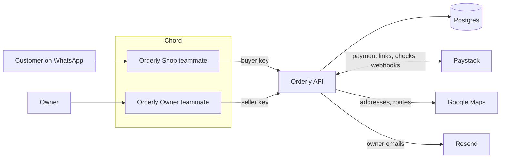

# Orderly

**WhatsApp is the store. Never sell twice. Never chase an alert.**

Small shops in Lagos sell on WhatsApp, but stock lives in someone's head, payment is "send me the transfer screenshot", and the same last phone gets sold to two people. Before building, I interviewed three Lagos sellers who sell on WhatsApp: all three had sold something already gone, and all three check their bank by hand before releasing an order ([customer discovery](docs/customer-discovery.md)). Orderly turns the chat into the store:

- **Customers** ask what's in stock, haggle, order for pickup or delivery, pay through a Paystack link and get a receipt, without leaving WhatsApp.
- **The owner** adds products, changes prices and stock, opens and closes stores and checks sales by chat, and gets an email the moment something needs them.

Two AI teammates run on [Chord](https://chordhq.xyz). This repo is the REST API they call, their skills, and the docs. Built by Samuel Owolabi for the TSG Labs Forward-deployed Engineering exercise.

## Try it

**As a customer**, open the shop's test chat: [chat.tsglabs.dev/c/q6-Wc-AfTG7keR-8DKOlmZ_7](https://chat.tsglabs.dev/c/q6-Wc-AfTG7keR-8DKOlmZ_7). Some things to type:

| Type this | What happens |
|---|---|
| How much is the iPhone 13? | Live price and stock per store, then it offers delivery |
| Can you do 600k? | A Lagos-style haggle. It counters twice, then holds, and never reveals the owner's floor |
| I want the 20W charger and AirPods Pro, I'll pick up | One order, one payment link, items held at two stores |
| 12 Admiralty Way, Lekki Phase 1, Lagos. 08031234567 | A delivery quote: distance, time with traffic, fee and total |
| PAID (after paying) | Checks Paystack and sends the receipt |
| Can I speak to the owner? | Asks for a number and emails the owner a call-back request |

To pay, use Paystack's test card: **4084 0840 8408 4081**, any future expiry, CVV **408**, PIN **0000**, OTP **123456**. No real money moves.

**As the owner**, the owner chat link is shared with the submission (it can change the live demo data). Try "Add 3 more iPhone 13 to Lekki", "How did we do today?", "We're closing Yaba" or "How much is delivery?".

The API is live at [orderly-o1ag.onrender.com](https://orderly-o1ag.onrender.com/health), and its OpenAPI spec is at [/openapi.json](https://orderly-o1ag.onrender.com/openapi.json).

## How it fits together



- The teammates never touch the database. Every price, stock figure and payment result comes from the API, and every rule is enforced there, not just in the prompts.
- The shop teammate uses the **buyer key** and can't change anything. The owner teammate uses the **seller key**.
- Paystack confirms payments two ways: a signed webhook the moment a payment lands, and a check when the customer replies PAID.
- Resend emails the owner, because a Chord teammate can't start a conversation by itself.

## The rules the API enforces

| Rule | How | Proved by |
|---|---|---|
| **Never sell twice** | Stock is held in one atomic update when the order is created, and released after 30 minutes unpaid. Every line is held at the store it's in, all or nothing. | Ten buyers racing for two units: exactly two get them |
| **Never confirm without Paystack** | Webhooks are signature-checked, and both paths check status, amount and currency against the order. A mismatch is never confirmed. | Wrong amount, wrong currency, declined card, Paystack down |
| **Never invent prices or stock** | Every figure comes from the database. Haggled prices must sit between the owner's floor and the list price, and a delivery order charges exactly what was quoted. | Below-floor offers refused, price changed mid-quote |
| **Customers can't change anything** | Buyer and seller keys, checked on every request. Chord gives every tool to both teammates, so the key is the real boundary. | Buyer key refused on every owner tool |
| **Late payments are handled** | Paid after the hold ran out: re-held if the stock is still there, otherwise marked for a refund and the owner is emailed. | Late payment with and without stock |

## What's inside

- **Haggling** with ready-made counter offers from the API, so the agent never sees a floor it could leak.
- **Pickup or delivery**, with Google-routed distance, traffic-aware times and a fee the owner sets by chat. Orders can span stores; delivery always leaves from one, and the owner's email lists what to bring over.
- **Owner by chat**: products, prices and discount floors, stock at any store, opening hours, closing a store and moving its stock, delivery pricing and sales reports.
- **Owner emails** for paid orders, refunds needed, payment problems and call-back requests, as simple HTML ([samples](docs/email-samples)).
- **Resilience**: retries for short Paystack and Google outages, and a delivery quote skips any store Google can't route from.

## Run it locally

You need Node 22+, Postgres and jq.

```bash
npm ci
cp .env.example .env     # then fill in the values
npm run db:create        # makes the role and database
npm run db:reset         # migrates and seeds Kola Gadgets
npm run dev              # serves on :3000
```

To run the tests, start the three local stand-ins for Paystack, Google and Resend, then the API pointed at them:

```bash
npm run fake-paystack & npm run fake-google & npm run fake-resend &
PAYSTACK_BASE_URL=http://localhost:4010 GOOGLE_GEOCODING_URL=http://localhost:4020/geocode/json \
  GOOGLE_ROUTES_URL=http://localhost:4020/routes RESEND_URL=http://localhost:4030/emails \
  RESEND_API_KEY=re_test OWNER_EMAIL=owner@example.com npm run dev
npm run db:seed && npm run test:api
```

The curl suite runs about 250 end-to-end checks: every tool, the failure cases, the last-unit race, late payments, webhooks, delivery and emails. `npm run test:retry`, `test:geocoding`, `test:hours` and `test:location` are small unit tests.

## Repo map

| Path | What's there |
|---|---|
| `src/` | The API: routes, controllers, services (the business rules), adapters (Paystack, Google, Resend), OpenAPI spec |
| `migrations/` | Plain SQL migrations, applied in order |
| `skills/` | The two Chord skills, the source of truth for what's published |
| `test/` | The curl suite, unit tests and the local stand-ins in `test/fakes/` |
| `docs/customer-discovery.md` | Interviews with three WhatsApp sellers, and how they shaped the build |
| `docs/PRD.md` | The problem, the users and the features |
| `docs/ENGINEERING.md` | Stack, data model, endpoints and Chord setup |
| `docs/field-notes.md` | What went wrong with Chord, with evidence, and what Chord should change |

## Stack

TypeScript, Express, Zod and zod-to-openapi, Postgres, Paystack (test mode), Google Maps (Geocoding and Routes), Resend, hosted on Render.
