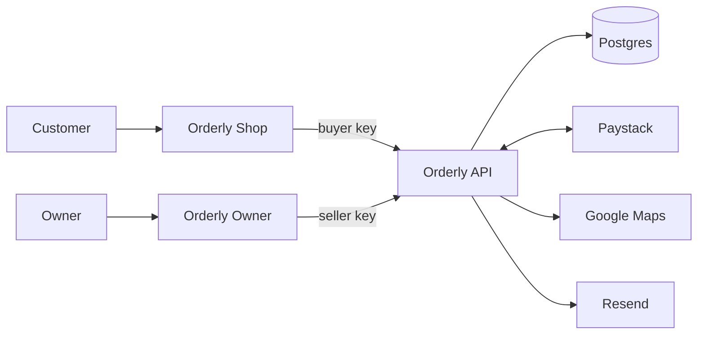

# Orderly

**Your whole shop, in the chat.**

Orderly is an AI sales assistant for shops that sell on WhatsApp and other chat apps. It answers customers, takes orders and confirms payments, and lets the owner run the shop by chat.

**For buyers**

| Problem | With Orderly |
|---|---|
| Waiting hours for a reply | You get an answer instantly, at any hour, from live prices and stock |
| The item is at another branch | Items from different branches come together in one order and one payment |
| Sent the money, heard nothing back | You get your receipt as soon as Paystack confirms |
| Not knowing the delivery fee or time | You see both upfront, from the real driving distance and traffic |
| Paying for something that's already gone | Your item is held the moment you say yes |
| Downloading and opening an app or visiting a website to shop | Everything happens in the chat you already use |

**For sellers**

| Problem | With Orderly |
|---|---|
| The same questions all day | They're answered for you, and customers bargain within your limit |
| Missing orders while busy or asleep | You get an email the moment an order is paid |
| Stock split across branches | You have one live count, so nothing is sold twice |
| Managing several branches | You open new ones, change hours, close them and move stock between them, all by chat |
| Checking every payment by hand | Paystack confirms every payment for you |
| Fake payment screenshots | A screenshot never confirms an order; only Paystack does |
| Updating stock and prices | You change them by chat, and customers see it at once |
| No record of sales | You ask "how did we do today?" and get real figures |

Two AI teammates run on [Chord](https://chordhq.xyz). This repo is the API they call, their skills and the docs. The demo shop is Kola Gadgets, a Lagos phone shop with three branches.

- Try the live agents: [SUBMISSION.md](SUBMISSION.md)
- Problems found in Chord: [field notes](docs/field-notes.md)
- Seller interviews: [customer discovery](docs/customer-discovery.md)

## Run it

Needs Node 22+ and Postgres.

```bash
npm ci
cp .env.example .env     # fill in the values; DATABASE_URL can be any Postgres
npm run db:migrate       # create the tables
npm run db:seed          # optional: load the demo shop (wipes existing data)
npm run dev              # http://localhost:3000
```

`/health` checks the database. `/openapi.json` is the spec Chord imports.

Tests: 259 end-to-end checks in `test/curl-tests.sh` (every tool, failure cases, the last-unit race, late payments, webhooks, delivery and emails), run against local fakes for Paystack, Google and Resend. Setup is in [CLAUDE.md](CLAUDE.md).

Deploy: `render.yaml` is a Render Blueprint for the API and database.

## How it works



- Customers chat with **Orderly Shop**; the owner chats with **Orderly Owner**. Both are Chord teammates.
- Neither holds any data. They call the Orderly API: the shop with a buyer key that can look up products and branches, quote delivery, place orders, check payments and request a call-back, the owner with a seller key that can also change products, prices, stock, branches and delivery pricing, and see sales.
- The API keeps everything in Postgres, takes and confirms payments with Paystack, prices delivery with Google Maps, and emails the owner through Resend.
- Every rule lives in the API, not in the prompts.

**Built with** TypeScript, Express, Zod (validation, and the OpenAPI spec generated from it), Postgres, Paystack test mode, Google Geocoding and Routes, Resend, and Render.

## Tools

Each tool is one endpoint under `/v1`, named by its `operationId` in the OpenAPI spec at [`/openapi.json`](https://orderly-o1ag.onrender.com/openapi.json), which is what Chord imports. The key column says which API keys it accepts.

| Tool | Endpoint | Key | Used by | What it does |
|---|---|---|---|---|
| `list_products` | `GET /products` | Buyer and seller | Shop | Prices, stock per branch, counter offers |
| `list_stores` | `GET /stores` | Buyer and seller | Shop | Address, map link, hours, open now |
| `get_receipt` | `GET /orders/{id}/receipt` | Buyer and seller | Both | Receipt for a paid order |
| `quote_delivery` | `POST /delivery/quote` | Buyer | Shop | Distance, time with traffic, fee and total |
| `create_order` | `POST /orders` | Buyer | Shop | Holds items, across branches if needed; one Paystack link |
| `verify_payment` | `POST /orders/{id}/verify` | Buyer | Shop | Checks Paystack; returns the receipt when paid |
| `contact_owner` | `POST /owner/contact` | Buyer | Shop | Emails the owner a number to call back |
| `owner_list_products` | `GET /owner/products` | Seller | Owner | Prices, floors, off-sale items, stock and held units |
| `owner_list_stores` | `GET /owner/stores` | Seller | Owner | Every branch, open or closed |
| `add_product`, `update_product` | `POST /products`, `PATCH /products/{id}` | Seller | Owner | Add products; change price, floor, details or stock |
| `add_store`, `update_store` | `POST /stores`, `PATCH /stores/{id}` | Seller | Owner | Open a branch; change hours, close, reopen or move stock |
| `delivery_settings` | `PATCH /delivery/settings` | Seller | Owner | Read or change the base fee and rate per km |
| `list_orders` | `GET /orders` | Seller | Owner | Sales by period, branch and status; what needs attention |

## Skills

Each teammate's instructions, matching what's published in Chord:

- Orderly Shop: [skills/orderly-shop/SKILL.md](skills/orderly-shop/SKILL.md)
- Orderly Owner: [skills/orderly-owner/SKILL.md](skills/orderly-owner/SKILL.md)

## Security and reliability

- API keys compared in constant time; the buyer key can't change prices, stock or stores.
- Paystack webhooks verified by HMAC-SHA512 signature on the raw body.
- The shop agent never sees discount floors, only ready-made counter offers.
- Secrets only in environment variables. Logs never record keys, bodies, names or phone numbers.
- Call-back requests limited to one per number every 30 minutes.
- Paystack and Google calls time out and retry up to three times; a branch Google can't route from is skipped; a failed email never blocks a payment.

## Repo

| Path | Contents |
|---|---|
| `src/` | Routes, controllers, services (business rules), adapters (Paystack, Google, Resend), OpenAPI |
| `migrations/` | SQL migrations |
| `skills/` | The two Chord skills |
| `test/` | Curl suite, unit tests, local fakes |
| `docs/` | PRD, engineering notes, field notes, interviews, email samples |

## How I used AI tools

- **Claude Code** for building the API, tests, skills and docs.
- **Codex** as a second reviewer and evaluator: it reviewed changes for bugs, and each finding was reproduced with a test before it was fixed.
- **[CLAUDE.md](CLAUDE.md)** and a code-style skill in `.agents/skills/` as standing instructions for every session.
- **Claude in Chrome** to publish skills in Chord, set up the simulator, read Render logs and run test chats, which is where the field notes' evidence comes from.
- **Chord** runs the two teammates.

Built by Samuel Owolabi for the TSG Labs Forward-deployed Engineering exercise.
