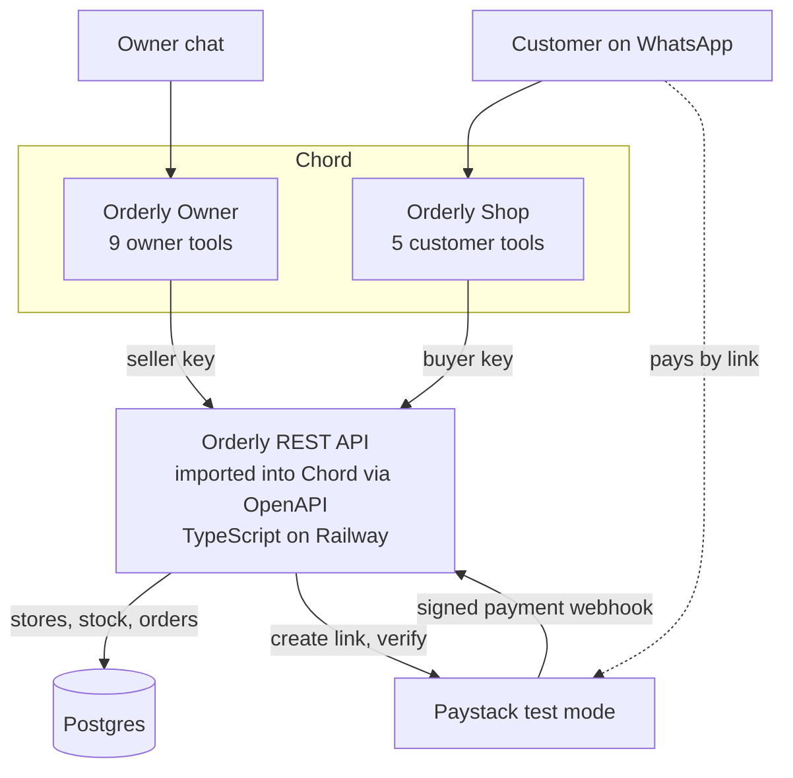
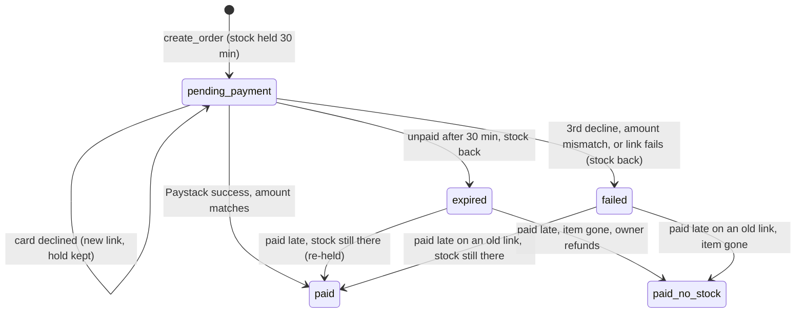

# Orderly: Engineering Design

Orderly is one small REST API that both Chord teammates call. The API owns stores, stock, orders and payments; Chord owns the conversations.

## At a glance

The customer pays on Paystack's own page, so card details never touch the agent, and only the API holds the Paystack key.

## Tech stack

| Part | Choice | Why |
| --- | --- | --- |
| API | TypeScript, Express, Zod | Zod schemas validate input; zod-to-openapi generates the spec Chord imports |
| Database | Postgres | Atomic stock updates stop overselling |
| Payments | Paystack test mode | Real API, test cards, no real money |
| Hosting | Railway, always on | No cold starts while reviewers test |
| AI teammates | Chord, two teammates | Conversations, tools, reminders and handover |

## Application structure

The API uses four layers:

| Directory | Responsibility |
| --- | --- |
| `src/routes/` | Wires Express endpoints to role checks and controllers |
| `src/controllers/` | Validates request data, calls a service and writes the HTTP response |
| `src/services/` | Enforces business rules and owns database, stock and payment workflows |
| `src/utils/` | Shared HTTP, currency, time, opening-hours and address helpers |
| `src/openapi/` | Owns API schemas, path descriptions, the registry and document generation |
| `src/middleware/` | Handles API-key roles, unknown routes and application errors |

`src/db/` contains connection, migration and seed code. Services do not depend on Express request or response objects, which keeps the business workflows reusable and easier to test. OpenAPI does not import Express routes or controllers, so the specification can be generated independently.

## Data

Six tables. Stores are rows, not fixed names, so an owner can run any number of them. Addresses are structured and may include coordinates, so agents can quote them consistently and share a map link or WhatsApp pin. Opening hours are rows too, so the API can say whether a store is open now. Money is stored in kobo, which is what Paystack uses; the agents only ever see naira.

| Table | Holds | Key columns |
| --- | --- | --- |
| stores | Each store or branch | id, name, structured address fields, optional latitude and longitude, active |
| store_hours | When each store is open, Lagos time | store_id, weekday (1 = Monday), opens, closes; a day with no row is closed |
| products | What the business sells | id (e.g. IP13-128), name, variant, price_kobo, min_price_kobo |
| stock | Units per product per store | product_id, store_id, available (never below 0) |
| orders | Each purchase | id (e.g. ORD-1042), product_id, store_id, amount_kobo, buyer_name, status, payment_references, paid_reference, expires_at |
| events | A log of everything that happened | order_id, type, detail, created_at |

The demo seeds Kola Gadgets with two stores, Ikeja and Lekki; the owner can add more by chat.

Order status is one of: `pending_payment`, `paid`, `failed`, `expired`, `paid_no_stock`, `handed_over`.

## API endpoints

Each endpoint becomes one tool in Chord when the OpenAPI spec is imported. Every response looks the same: `{ ok, data, error: { code, message_for_agent } }`.

| Tool | Endpoint | Orderly Shop | Orderly Owner | What it does |
| --- | --- | --- | --- | --- |
| list_stores | `GET /stores` | Yes | Yes | Store names, structured addresses, map links, opening hours and whether each is open now |
| list_products | `GET /products` | Yes | Yes | Prices and stock at each store; filter by store |
| create_order | `POST /orders` | Yes | No | Holds stock at the chosen store for 30 minutes and returns a Paystack link |
| verify_payment | `POST /orders/{id}/verify` | Yes | No | Checks Paystack, confirms the order, returns the receipt |
| get_receipt | `GET /orders/{id}/receipt` | Yes | Yes | The receipt for a paid order |
| add_store | `POST /stores` | No | Yes | A new store or branch |
| update_store | `PATCH /stores/{id}` | No | Yes | Change a store's name, structured address, map pin or opening hours |
| add_product | `POST /products` | No | Yes | New product with stock at one or more stores |
| update_stock | `POST /products/{id}/stock` | No | Yes | Change stock at one store |
| update_price | `PATCH /products/{id}` | No | Yes | Change a price (the same at every store) |
| list_orders | `GET /orders` | No | Yes | Orders by status and store, including handed-over ones |

Chord's built-in tools cover the rest: `schedule_reminder` for the payment nudge and `handover_to_human` for escalation.

`POST /webhooks/paystack` is infrastructure, not a Chord tool, so it is deliberately absent from OpenAPI. Paystack calls it with a signed `charge.success` event.

`list_stores` always returns a clickable map URL. When latitude and longitude are present, Chord can also use them for a native WhatsApp location message if the channel exposes that message type. Otherwise it sends the address and map URL as text.

## Payment states

Only a verified Paystack payment marks an order paid. The signed webhook is the primary confirmation path. `verify_payment` remains the fallback when the webhook is delayed and lets Chord retrieve the final state and receipt during the conversation.

- **Paystack references.** Each payment link gets its own reference: the order id plus a random suffix (`ORD-1001-3fa9c2`). Paystack references are unique across the account forever, so plain order ids would collide after a reseed, or between local dev and Railway on the same test key. An order keeps every reference it has had, and verify checks all of them, newest first, so a payment finished on an older page is still found.
- **Webhook authentication.** The API computes an HMAC-SHA512 digest from the unparsed request bytes and the Paystack secret, then compares it with `x-paystack-signature`. Invalid signatures are rejected before any payment data is used.
- **Idempotency.** Both webhook and polling confirmation lock the order row and use the same payment transition. A repeated notification returns the existing outcome without taking stock or writing another payment event. The exact successful reference is stored in `paid_reference` for the receipt.
- **Declined cards.** A decline keeps the hold and returns a new link. After the second decline, `next_step` tells the agent to hand over; the third cancels the order and releases the stock.
- **Expiry.** Holds are expired, and their stock returned, in one SQL statement. It runs before every stock-dependent request and every 60 seconds in the server.

## Chord setup

Both teammates exist with placeholder skills; the real skills go in once the API works.

| Setting | Orderly Shop | Orderly Owner |
| --- | --- | --- |
| Role | Sales assistant | Store operations assistant |
| Autonomy | Act independently | Act independently |
| Chat link business name | Kola Gadgets | Kola Gadgets (Owner) |
| API tools | 5 customer tools | 9 owner tools |
| Built-in tools | schedule_reminder, handover_to_human | none yet |
| Escalation triggers | Payment failed twice; paid twice; complaint; question it cannot answer; discount request | none |
| Other | Credit budget | Credit budget; accepts requests from teammates |

Skill edits only take effect after the draft is **published**. Skill files live in the repo and are uploaded from there.

## Safety and errors

The API enforces the rules, so a confused or tricked agent still can't break them.

**Safety**

- **Two API keys.** Customer tools send a buyer key, owner tools a seller key. The API refuses owner actions on the buyer key.
- **No overselling.** Stock is held with one atomic update: `UPDATE stock SET available = available - qty WHERE available >= qty`.
- **Paystack is the truth.** Signed webhooks and explicit verification both check status, amount and currency before marking an order paid.
- **Secrets stay on the server.** The Paystack test key lives only in the API's environment, never in Chord.

**When things fail**

| Failure | API does | Agent says |
| --- | --- | --- |
| Paystack link fails | Releases the held stock, marks the order failed | Sorry, try again; hands over on the second failure |
| Card declined | Keeps the hold, makes a new link | Sends the new link; hands over after the second decline |
| Paystack doesn't answer | Retries once, then reports it | "I can't confirm right now"; hands over |
| Amount doesn't match | Marks the order failed | Hands over; never confirms |
| Paid after the hold expired, item gone | Marks it `paid_no_stock` | Tells the customer honestly; owner refunds |
| Bad input | Names the missing field | Asks the customer for it |

## Build order

About 5 hours of build, each step done before the next starts. Chord credits are only spent from step 4.

1. **Database and seed data** (30 min): the six tables, Kola Gadgets' two stores and their products.
2. **Endpoints** (1 hr): all eleven, with Paystack test calls, tested with curl including the failure cases.
3. **Deploy and import** (30 min): Railway, generate the OpenAPI spec, import into Chord, assign tools and keys per teammate.
4. **Orderly Shop skill** (1 hr): real skill, escalation triggers, full order test in the simulator.
5. **Orderly Owner skill** (45 min): add stock by chat, then a customer buys it.
6. **Edge cases** (45 min): two buyers on the last unit, declined card, quiet customer, late payment, handover.

Then the README, field notes, go-live note and recording.
