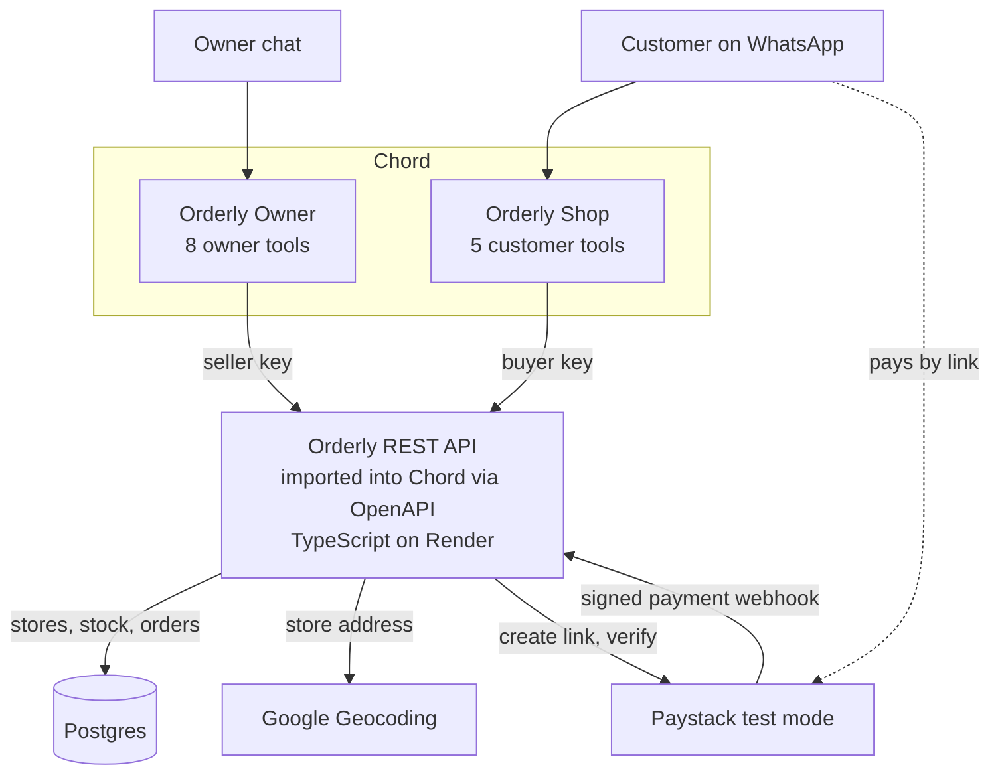
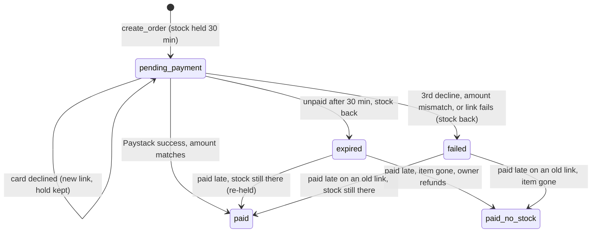

# Orderly: Engineering Design

Orderly is one small REST API that both Chord teammates call. The API owns stores, stock, orders and payments; Chord owns the conversations.

## At a glance

The customer pays on Paystack's own page, so card details never touch the agent, and only the API holds the Paystack key.

## Tech stack

| Part | Choice | Why |
| --- | --- | --- |
| API | TypeScript, Express, Zod | Zod schemas validate input; zod-to-openapi generates the spec Chord imports |
| Database | Postgres | Atomic stock updates stop overselling |
| Geocoding | Google Geocoding API | Turns a store address into an optional map pin, and says how precise the match is |
| Payments | Paystack test mode | Real API, test cards, no real money |
| Owner alerts | Resend (email) | Tells the owner about paid orders, refunds needed and customers asking for a person, since Chord can't start a conversation |
| Hosting | Render, from a Blueprint (`render.yaml`) | Web service and Postgres defined in the repo. A paid instance stays on; the free one sleeps when idle |
| AI teammates | Chord, two teammates | Conversations, tools and handover |

## Application structure

The API is split into focused modules:

| Directory | Responsibility |
| --- | --- |
| `src/routes/` | Wires Express endpoints to role checks and controllers |
| `src/controllers/` | Validates request data, calls a service and writes the HTTP response |
| `src/services/` | Enforces business rules and owns database, stock and payment workflows |
| `src/adapters/` | Defines external-provider contracts and translates Google and Paystack responses into application data |
| `src/utils/` | Shared HTTP, currency, time, opening-hours and address helpers |
| `src/openapi/` | Owns API schemas, path descriptions, the registry and document generation |
| `src/middleware/` | Handles API-key roles, unknown routes and application errors |
| `test/` | Curl suite and unit tests; `test/fakes/` stands in for Paystack, Google Maps and Resend (not shipped) |
| `scripts/` | Developer scripts such as creating the local database (not shipped) |

`src/db/` contains connection, migration and seed code. Services do not depend on Express request or response objects, which keeps the business workflows reusable and easier to test. Services call the `PaymentProcessor`, `GeocodingProvider` and `RoutingProvider` interfaces. `src/adapters/index.ts` is the single composition point that creates the Paystack and Google adapters, so provider payloads stay out of business logic. OpenAPI does not import Express routes or controllers, so the specification can be generated independently.

## Data

Ten tables. Stores are rows, not fixed names, so an owner can run any number of them. Addresses are structured and may include coordinates, so agents can quote them consistently and share a map link or WhatsApp pin. Opening hours are rows too, so the API can say whether a store is open now. Money is stored as integer subunits (kobo for NGN), which is what Paystack expects, always next to its ISO 4217 currency code. New products are priced in `BUSINESS_CURRENCY` (default NGN), an order copies its products' currency (one currency per order), and payment checks compare Paystack's currency to the order's. Only `src/utils/money.ts` knows how big a currency's subunit is; the API returns every amount as `{ amount, currency, display }` in the main unit.

| Table | Holds | Key columns |
| --- | --- | --- |
| stores | Each store or branch | id, name, structured address fields, optional latitude and longitude, active |
| store_hours | When each store is open, in `BUSINESS_TIMEZONE` | store_id, weekday (1 = Monday), opens, closes; a day with no row is closed |
| products | What the business sells | id (e.g. IP13-128), name, variant, price_subunit, min_price_subunit, currency |
| stock | Units per product per store | product_id, store_id, available (never below 0) |
| orders | Each purchase: one payment link; store_id is the main store (where a delivery leaves from, or the first pickup store) | id (e.g. ORD-1042), store_id, amount_subunit (the total), currency, buyer_name, status, payment_references, paid_reference, expires_at |
| order_items | The lines of an order, each held at its own store | order_id, line, product_id, store_id, quantity, unit_price_subunit, list_price_subunit (before bargaining), amount_subunit |
| delivery_quotes | A priced trip from a store to a customer's address; an order uses at most one | id (e.g. DQ-3F9A2C1B), store_id, address, phone, distance_m, duration_s, fee_subunit, currency, prep_minutes, item_stores (where each product is held), transfer_minutes (bringing items over from other stores), matched_area (set when only the area was found; the rider calls), expires_at |
| delivery_settings | The owner's delivery pricing (one row; none means the env defaults) | currency, base_fee_subunit, fee_per_km_subunit |
| owner_contacts | Customers who asked for the owner; limits each number to one call-back email every 30 minutes | name, phone, phone_key, reason, order_id, emailed, created_at |
| events | A log of everything that happened | order_id, type, detail, created_at |

The demo seeds Kola Gadgets with three stores, Ikeja, Lekki and Yaba; the owner can add more by chat. `npm run db:seed:test` seeds only Ikeja and Lekki, because the curl suite opens, edits and closes Yaba itself. When a new store omits `location`, or a store's address changes without one, the API geocodes the structured address with Google. Vague matches give no pin rather than a wrong one: Google's `APPROXIMATE` results are dropped, and the map link then searches the address. Explicit coordinates always win, and `location: null` deliberately stores no pin.

Order status is one of: `pending_payment`, `paid`, `failed`, `expired`, `paid_no_stock`, `handed_over`.

## API endpoints

Each endpoint becomes one tool in Chord when the OpenAPI spec is imported. Every response looks the same: `{ success, data, error: { code, message_for_agent } }`.

Tool endpoints below are relative to `/v1` (for example `POST /v1/orders`); the spec's server URL includes it. `/health`, `/openapi.json` and `/webhooks/paystack` are unversioned.

| Tool | Endpoint | Orderly Shop | Orderly Owner | What it does |
| --- | --- | --- | --- | --- |
| list_stores | `GET /stores` | Yes | Yes | Store names, structured addresses, map links, opening hours and whether each is open now |
| list_products | `GET /products` | Yes | Yes | Prices and stock at each store; filter by store |
| owner_list_stores | `GET /owner/stores` | No | Yes | Every store, closed ones included (the owner's view; in Chord the shared list_stores carries the buyer key) |
| owner_list_products | `GET /owner/products` | No | Yes | Products with floors, off-sale items, closed stores' stock and units held for unpaid orders |
| quote_delivery | `POST /delivery/quote` | Yes | No | Prices delivery from one store (the nearest with everything, or the nearest with some of it, the rest brought over first): driving distance, traffic-aware time, fee and total |
| contact_owner | `POST /owner/contact` | Yes | No | Emails the owner a customer's name, number and reason so the owner calls back (one per number every 30 minutes) |
| create_order | `POST /orders` | Yes | No | Holds one or more items at the chosen store for 30 minutes (all or nothing) and returns one Paystack link for the total |
| verify_payment | `POST /orders/{id}/verify` | Yes | No | Checks Paystack, confirms the order, returns the receipt |
| get_receipt | `GET /orders/{id}/receipt` | Yes | Yes | The receipt for a paid order |
| add_store | `POST /stores` | No | Yes | A new store or branch, with automatic address geocoding when no location is supplied |
| update_store | `PATCH /stores/{id}` | No | Yes | Change a store's name, structured address, map pin or opening hours; close (active false) or reopen it; move all its free stock to another store (move_stock_to) |
| add_product | `POST /products` | No | Yes | One or more new products with stock at any stores, added together or not at all |
| update_product | `PATCH /products/{id}` | No | Yes | Change any mix of price, discount floor, name, variant, on-sale status and stock at several stores, in one call |
| delivery_settings | `PATCH /delivery/settings` | No | Yes | Reads (empty body) or changes the delivery pricing: base fee, rate per km, rounding, distance limit, packing time |
| list_orders | `GET /orders` | No | Yes | Orders by status and store, including handed-over ones |

Chord's built-in `handover_to_human` covers escalation. Payment is confirmed when the customer replies PAID (the agent calls `verify_payment`) and by Paystack's webhook; there are no scheduled reminders (field note 4).

`POST /webhooks/paystack` is infrastructure, not a Chord tool, so it is deliberately absent from OpenAPI. Paystack calls it with a signed `charge.success` event.

`list_stores` always returns a clickable map URL. When latitude and longitude are present, Chord can also use them for a native WhatsApp location message if the channel exposes that message type. Otherwise it sends the address and map URL as text.

## Payment states

Only a verified Paystack payment marks an order paid. The signed webhook is the primary confirmation path. `verify_payment` remains the fallback when the webhook is delayed and lets Chord retrieve the final state and receipt during the conversation.

- **Paystack references.** Each payment link gets its own reference: the order id plus a random suffix (`ORD-1001-3fa9c2`). Paystack references are unique across the account forever, so plain order ids would collide after a reseed, or between local dev and the deployed API on the same test key. An order keeps every reference it has had, and verify checks all of them, newest first, so a payment finished on an older page is still found.
- **Webhook authentication.** The API computes an HMAC-SHA512 digest from the unparsed request bytes and the Paystack secret, then compares it with `x-paystack-signature`. Invalid signatures are rejected before any payment data is used.
- **Payment adapter.** `PaystackAdapter` owns checkout initialization, verification retries, signature validation and webhook normalization. Order workflows consume only normalized transaction and webhook types.
- **Idempotency.** Both webhook and polling confirmation lock the order row and use the same payment transition. A repeated notification returns the existing outcome without taking stock or writing another payment event. The exact successful reference is stored in `paid_reference` for the receipt.
- **Declined cards.** A decline keeps the hold and returns a new link. After the second decline, `next_step` tells the agent to hand over; the third cancels the order and releases the stock.
- **Expiry.** Holds are expired, and their stock returned, in one SQL statement. It runs before every stock-dependent request and every 60 seconds in the server.

## Chord setup

| Setting | Orderly Shop | Orderly Owner |
| --- | --- | --- |
| Role | Sales assistant | Store operations assistant |
| Autonomy | Act independently | Act independently |
| Chat link business name | Kola Gadgets | Kola Gadgets |
| API tools | 7 customer tools (buyer key) | 9 owner tools, all seller key except get_receipt; 15 in the spec |
| Built-in tools | handover_to_human | none yet |
| Escalation triggers | Payment failed twice; amount mismatch or Paystack unreachable; paid after stock sold; complaint or refund; final bargained price refused; question it cannot answer | none |
| Other | Credit budget | Credit budget; accepts requests from teammates |

Skill edits only take effect after the draft is **published**. Skill files live in the repo and are uploaded from there.

## Safety and errors

The API enforces the rules, so a confused or tricked agent still can't break them.

**Safety**

- **Two API keys.** Customer tools send a buyer key, owner tools a seller key. The API refuses owner actions on the buyer key.
- **No overselling.** Stock is held with one atomic update: `UPDATE stock SET available = available - qty WHERE available >= qty`.
- **Paystack is the truth.** Signed webhooks and explicit verification both check status, amount and currency before marking an order paid.
- **Secrets stay on the server.** The Paystack test key lives only in the API's environment, never in Chord.
- **Known limitation in Chord.** Imported API tools reach every teammate, and each connection holds one key. So Orderly Shop can see the owner tools, which carry the seller key. The API still enforces the key on every call, but on the shop side only the skill keeps the agent from changing prices or stock. Going live needs per-teammate tool access in Chord, or a teammate identity the API can check.

**When things fail**

| Failure | API does | Agent says |
| --- | --- | --- |
| Paystack link fails | Releases the held stock, marks the order failed | Sorry, try again; hands over on the second failure |
| Card declined | Keeps the hold, makes a new link | Sends the new link; hands over after the second decline |
| Paystack doesn't answer | Retries once, then reports it | "I can't confirm right now"; hands over |
| Amount doesn't match | Marks the order failed | Hands over; never confirms |
| Paid after the hold expired, item gone | Marks it `paid_no_stock` | Tells the customer honestly; owner refunds |
| Bad input | Names the missing field | Asks the customer for it |

## Build order

About 5 hours of build, each step done before the next starts. Chord credits are only spent from step 4.

1. **Database and seed data** (30 min): the tables, Kola Gadgets' stores and their products.
2. **Endpoints** (1 hr): the core tools, with Paystack test calls, tested with curl including the failure cases.
3. **Deploy and import** (30 min): Render, generate the OpenAPI spec, import into Chord, assign tools and keys per teammate.
4. **Orderly Shop skill** (1 hr): real skill, escalation triggers, full order test in the simulator.
5. **Orderly Owner skill** (45 min): add stock by chat, then a customer buys it.
6. **Edge cases** (45 min): two buyers on the last unit, declined card, quiet customer, late payment, handover.

Then the README, field notes, go-live note and recording.
