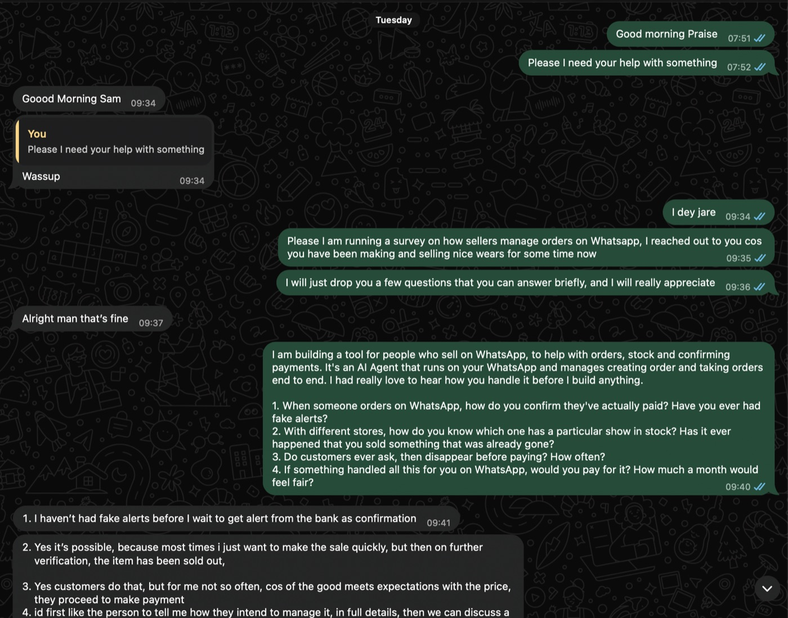
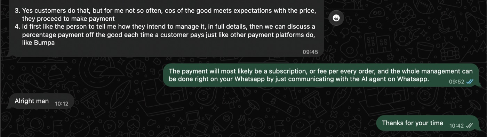
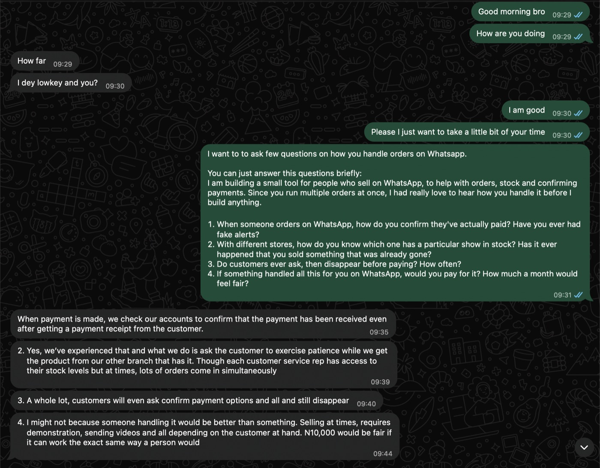
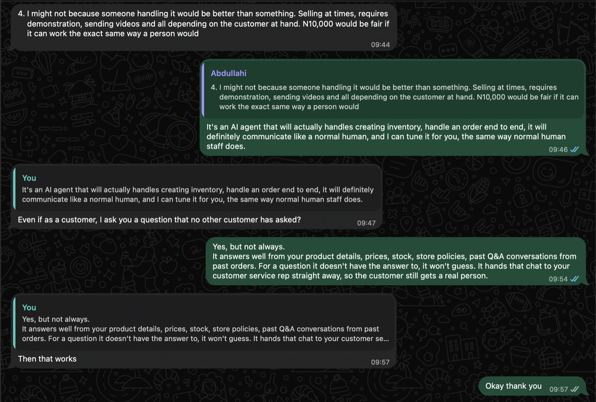
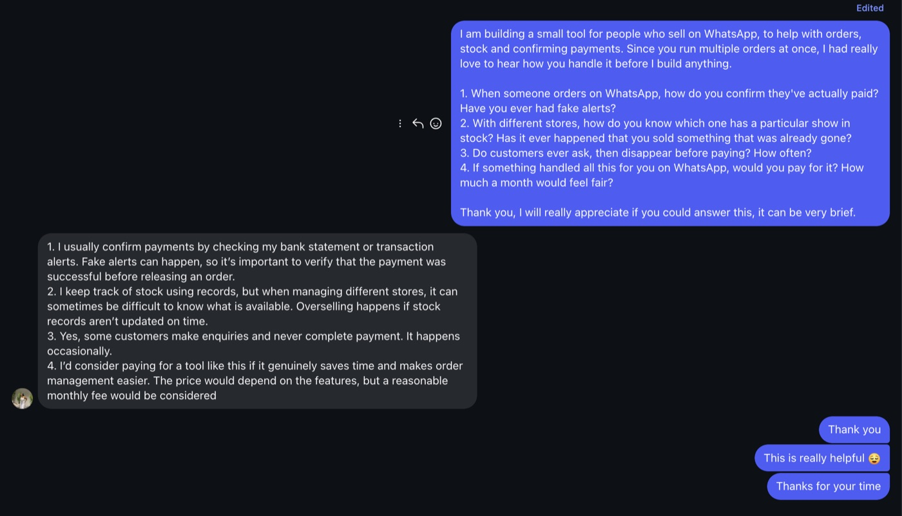

# Seller interviews

Before building, I asked three Lagos sellers who sell on WhatsApp how they handle orders today. Each agreed to be quoted.

## How

- **By message:** Sellers A and B on WhatsApp, Seller C in a direct message on another app.
- **Same four questions for everyone,** sent in one message, with a note that I was building a tool and wanted to hear how they work before building anything.

## Who

| Seller | Business |
| --- | --- |
| Seller A | Makes and sells clothing |
| Seller B | Sells across multiple branches |
| Seller C | Sells across multiple stores |

## Questions asked

1. When someone orders on WhatsApp, how do you confirm they have actually paid? Have you ever had fake alerts?
2. With different stores, how do you know which one has an item in stock? Have you ever sold something that was already gone?
3. Do customers ever ask, then disappear before paying? How often?
4. If something handled all this for you on WhatsApp, would you pay for it? How much would feel fair?

## Findings

| Finding | Count | What they said |
| --- | --- | --- |
| Overselling | 3 of 3 | A: "most times I just want to make the sale quickly, but then on further verification, the item has been sold out." B: "lots of orders come in simultaneously." C: "Overselling happens if stock records aren't updated on time." |
| Manual payment checks | 3 of 3 | All check their bank before releasing an order. B checks "even after getting a payment receipt from the customer." |
| Disappearing buyers | 3 of 3, at different rates | B: "A whole lot, customers will even ask confirm payment options and all and still disappear." A: not often. C: occasionally. |
| Multiple stores | 2 of 3 | B and C run more than one location. |
| Fake alerts | 1 of 3 | C: "Fake alerts can happen, so it's important to verify that the payment was successful before releasing an order." A has never had one. |

### The chats

**Seller A**, clothing

**Seller B**, multiple branches

**Seller C**, multiple stores

## Pricing

- Seller A: a percentage per sale, like Bumpa.
- Seller B: ₦10,000 a month, "if it can work the exact same way a person would".
- Seller C: a reasonable monthly fee, depending on features.

## The trust objection

Seller B said "someone handling it would be better than something", because selling sometimes needs demos and videos. After hearing that the agent hands anything it can't answer to a real person, Seller B replied: "Then that works."

## How the findings shaped the build

| Finding | What Orderly does |
| --- | --- |
| Overselling | Stock is held atomically per store the moment an order is made, for 30 minutes; a delivery order is held with its Paystack link in the same message. Orders can take items from several stores, each held where it is. Two buyers can never get the last unit. |
| Manual payment checks | Paystack confirms every payment, by signed webhook and when the customer replies PAID, checking status, amount and currency against the order. The owner never has to open the bank app. |
| Fake alerts | A screenshot or "I've paid" is never proof. Only Paystack's confirmation releases an order. |
| Multiple stores | Stores are rows in a table, with stock tracked per store. The owner can open, close and move stock between stores by chat. |
| Disappearing buyers | The hold runs out after 30 minutes and the stock goes back on sale. The plan was also a reminder to quiet buyers, but Chord's reminder messages never reach the simulator, so it was removed (see [field notes](../field-notes/README.md), note 4). |
| Trust objection | Anything the agent can't answer goes to a person. A customer who asks for the owner gives their number, and the owner gets an email to call them back. |

## Gaps (next steps)

- Sending product demos and videos to customers.
- Choosing between per-sale and monthly pricing.

## How this became Kola Gadgets

Kola Gadgets is made up, but it's built from these three sellers' problems.

Kola Gadgets, a busy Yoruba man's shop in Lagos with three branches, Ikeja, Lekki and Yaba, takes orders on WhatsApp from morning till midnight. The same questions come in nonstop ("how much?", "is it available?", "how much is delivery?"), and a slow reply at 11pm or in a rush hour sends the buyer to the next shop. Behind the chat, nothing is in one place: checking stock means calling another branch, the delivery fee is a guess, every "I've paid" means digging through the bank app, and the only sales record is the chat itself.

So when orders pile up, mistakes happen. Ikeja sells the last iPhone while Lekki is promising it to someone else, or an order goes out on a fake screenshot before anyone has confirmed the money actually arrived.
